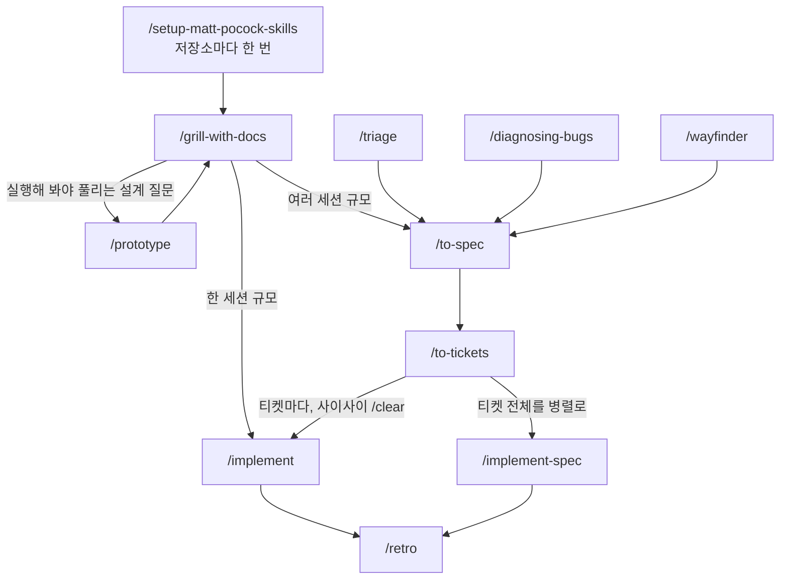

# my-claude-code-settings


`~/.claude` 디렉터리를 그대로 git으로 추적하는 Claude Code 개인 설정 저장소입니다. 저장소를 `~/.claude`에 clone하면 규칙, 스킬, 훅, 에이전트가 Claude Code가 읽는 위치에 바로 놓입니다. 개발은 [Matt Pocock의 스킬](https://github.com/mattpocock/skills) 플로우로 진행하고 응답과 문서는 한국어 출력 스타일로 씁니다.

## 설계 원칙

- **강제 라우팅 없음**: 개발 플로우의 각 단계는 사용자가 슬래시 명령을 칠 때만 시작됩니다. 에이전트가 다음 단계로 넘어가지 않도록 훅이 단계마다 멈추게 하고 다음에 칠 명령만 알려 줍니다
- **상주 비용 관리**: 스킬 목록은 매 세션 컨텍스트에 실립니다. 그래서 쓰지 않는 스킬 30개를 `settings.json`의 `skillOverrides`로 꺼 둡니다
- **한 곳에 두는 규칙**: 행동 규칙은 `rules/`에, 한국어 문체는 `output-styles/korean.md`에만 둡니다. 스킬은 이 규칙을 다시 적지 않고 따릅니다
- **필요할 때만 주는 도구 안내**: CodeGraph 안내는 프로젝트에 `.codegraph/` 인덱스가 있을 때만 훅이 주입합니다. 도구별 사용 규칙은 그 도구를 쓰는 프로젝트의 `CLAUDE.md`에 둡니다
- **머신 로컬 설정 분리**: 이 머신에만 있는 CLI에 의존하는 훅은 git 필터가 커밋에서 걷어냅니다

## 빠른 시작

```bash
git clone https://github.com/otzslayer/my-claude-code-settings.git ~/.claude
bash ~/.claude/scripts/install.sh
```

설치가 끝나면 Claude Code를 재시작합니다. 재시작할 때 Claude Code가 `settings.json`의 `enabledPlugins`를 읽어 플러그인을 설치합니다. 설치기가 무엇을 하는지, 수동으로 설치하는 방법, clone 뒤에 꼭 확인할 필터 설정은 [`docs/setup.md`](docs/setup.md)에 정리했습니다.

## 저장소 구성

이 저장소는 직접 만든 구성 요소만 추적하고 플러그인과 npm으로 설치하는 스킬은 추적하지 않습니다.

| 경로 | 내용 |
|---|---|
| `CLAUDE.md` | 전역 개발 지침: 작업 순서, 스킬 호출 규칙, 범위 확인, `TODO.md` 관리 |
| `rules/` | 행동 규칙 4종 (아래 "규칙 파일 계층") |
| `output-styles/korean.md` | 한국어 출력 스타일 |
| `skills/` | 직접 만든 스킬 9종 |
| `commands/` | Obsidian 노트용 슬래시 커맨드 3종 |
| `hooks/` | 훅 스크립트 4종 |
| `agents/` | 서브에이전트 정의 14종 |
| `scripts/` | 설치기, `settings.json` 필터, 메모리 seed 동기화 |
| `docs/` | 설계 스펙(`docs/superpowers/specs/`), 학습 기록(`docs/solutions/`), 설치 문서 |

### 스킬

| 스킬 | 하는 일 |
|---|---|
| `write-korean-doc` | 한국어 문서를 인터뷰부터 점검 스크립트까지 거쳐 새로 씀 |
| `polish-korean` | 이미 쓴 한국어 산문을 하우스 스타일로 교정하고 내용 문제는 보고함 |
| `translate-doc` | 영어 마크다운을 한국어로 번역함. `/translate-doc`으로만 실행됨 |
| `write-korean-docstring` | Python 패키지의 docstring을 한국어 습니다체로 쓰거나 통일함 |
| `capturing-learnings` | 끝난 작업에서 배운 것 하나를 `docs/solutions/`에 기록함. 기록할 것이 없으면 쓰지 않음 |
| `python-coding-style` | Python 코드 스타일과 ruff 설정의 원본 |
| `python-architecture` | Python 프로젝트의 레이어드 구조와 의존 방향 |
| `fastapi-project-structure` | FastAPI 프로젝트 스캐폴딩 템플릿 |
| `editorial-flow-diagram` | 흐름도를 엔지니어링 블로그 스타일의 PNG나 SVG로 다시 그림 |

### 커맨드와 훅

| 이름 | 종류 | 하는 일 |
|---|---|---|
| `/tag-doc` | 커맨드 | 마크다운 frontmatter에 영어 기술 태그를 붙임. `/translate-doc`의 앞 단계 |
| `/banner-doc` | 커맨드 | 퍼블릭 도메인 역사 이미지를 찾아 Pixel Banner frontmatter에 기록함 |
| `/add-banner-from-unsplash` | 커맨드 | Unsplash 사진 세 장 가운데 하나를 고르게 해 Pixel Banner frontmatter에 기록함 |
| `mattpocock-flow.sh` | `UserPromptSubmit` 훅 | 플로우 명령을 치면 세션당 한 번 정지 규칙과 단계 안내를 주입함 |
| `python-style-once.sh` | `PreToolUse` 훅 | `.py` 파일을 편집할 때 `python-coding-style`을 세션당 한 번 안내함 |
| `notify_stop.sh`, `notify_noti.sh` | `Stop`, `Notification` 훅 | macOS 알림 CLI인 grrr로 알림을 보냄. 등록은 머신 로컬이라 커밋되지 않음 |

`settings.json`에는 스크립트 없이 jq 한 줄로 쓴 훅도 있습니다. `docs/plans/`, `docs/superpowers/specs/`, `docs/solutions/`에 마크다운을 쓸 때 한국어로 쓰라고 주입하는 훅과, `.codegraph/`가 있는 프로젝트에서 CodeGraph를 먼저 쓰라고 안내하는 훅입니다.

에이전트 14종은 `architect`, `backend-developer`, `build-error-resolver`, `code-reviewer`, `doc-updater`, `e2e-runner`, `microservices-architect`, `planner`, `polish-korean-worker`, `python-pro`, `refactor-cleaner`, `refactoring-specialist`, `security-reviewer`, `tdd-guide`입니다.

## 개발 워크플로우

개발은 mattpocock-skills 플러그인의 플로우를 따릅니다. 아이디어를 인터뷰로 다듬은 뒤 작업 규모에 따라 바로 구현하거나 스펙과 티켓을 거쳐 구현하고 마지막에 세션을 회고합니다.



| 명령 | 하는 일 | 결과 |
|---|---|---|
| `/setup-matt-pocock-skills` | 이슈 트래커, triage 라벨, 도메인 문서 위치를 저장소마다 한 번 설정함 | 저장소 설정 |
| `/grill-with-docs` | 계획이나 설계를 집요한 인터뷰로 다듬음 | ADR(설계 결정 기록)과 용어집 |
| `/prototype` | 버리는 프로토타입으로 설계 질문에 답함 | 답을 확인한 뒤 인터뷰로 돌아감 |
| `/to-spec` | 지금까지 나눈 대화를 인터뷰 없이 스펙으로 합성함 | 트래커의 스펙 |
| `/to-tickets` | 스펙을 끝에서 끝까지 동작하는 작은 티켓으로 나누고 차단 관계를 적음 | 티켓. 로컬 트래커면 `.scratch/<feature-slug>/issues/` |
| `/implement` | 스펙이나 티켓 하나를 구현함. 안에서 `/tdd`를 돌리고 `/code-review`로 마무리함 | 커밋 |
| `/implement-spec` | 티켓 전체를 서브에이전트별 worktree에서 구현해 통합 브랜치 하나로 모음 | 통합 브랜치 |
| `/retro` | 세션을 돌아보고 다음 실행을 위한 환경 개선점을 찾음 | 개선점 목록 |

`/triage`(밖에서 들어온 이슈), `/diagnosing-bugs`(고장 난 것), `/wayfinder`(한 세션에 들어가지 않는 큰 일)는 `/to-spec`에서 메인 플로우에 합류합니다.

플로우를 쓸 때 지킬 점이 몇 가지 있습니다.

- **단계마다 멈춤**: 플로우 스킬 대부분은 `disable-model-invocation: true`라서 모델이 보는 스킬 목록에 나타나지 않습니다. 그래서 모델은 스킬이 없다고 답하거나 다음 단계의 산출물을 직접 만들기 쉽습니다. `mattpocock-flow.sh` 훅이 이 두 경우를 막고 다음에 칠 명령을 알린 뒤 멈추게 합니다
- **컨텍스트 유지**: `/to-tickets`를 마칠 때까지는 한 컨텍스트에서 진행하고 `/compact`나 `/clear`를 하지 않습니다
- **티켓의 심볼 줄**: 훅이 티켓마다 건드릴 기존 심볼 이름을 `**Symbols:**` 줄로 남기게 합니다. `/implement`는 첫 턴에 이 이름을 CodeGraph 조회에 넘깁니다
- **리뷰 명령 이름**: 접두사 없는 `/code-review`는 Claude Code에 내장된 리뷰입니다. Matt의 리뷰를 직접 부르려면 `/mattpocock-skills:code-review`를 칩니다
- **이 저장소에서는 설정 명령을 쓰지 않음**: `/setup-matt-pocock-skills`는 저장소 최상위의 `CLAUDE.md`를 고치는데 이 저장소에서는 그 파일이 전역 지침입니다

## 한국어 문서 작업

모든 응답과 문서의 문체는 `output-styles/korean.md`가 정합니다. `settings.json`의 `outputStyle`이 이 스타일을 지정하고 스타일 파일은 시스템 프롬프트에 들어갑니다. 스킬은 이 스타일에 작업 종류별 절차를 더합니다.

| 작업 | 쓰는 것 |
|---|---|
| 새 문서 쓰기 | `write-korean-doc`: 인터뷰, 원문 재확인, 개요 확인, 절별 작성, `scripts/check.py` 점검 |
| 이미 쓴 글 다듬기 | `polish-korean`: 파일 단위 작업은 `polish-korean-worker` 에이전트에 맡김 |
| 영어 문서 번역 | `/tag-doc`으로 태그를 붙인 뒤 `/translate-doc` |
| Python docstring | `write-korean-docstring` |

## 코드 탐색 도구

CodeGraph와 graphify는 프로젝트마다 따로 켭니다. 인덱스가 없는 저장소에서는 전역 안내가 쓸모없거나 틀린 말이 되기 때문입니다.

| 도구 | 프로젝트에서 켜는 명령 | 안내가 전달되는 방식 |
|---|---|---|
| CodeGraph | `codegraph init` (MCP는 `install.sh`가 전역 등록함) | MCP 서버가 사용법을 직접 보내고 `.codegraph/`가 있으면 훅이 추가 안내를 주입함 |
| graphify | `graphify install --project --platform claude` 뒤 `graphify update .` | CLI라 자동 안내가 없으므로 `graphify-out/` 사용 규칙을 프로젝트 `CLAUDE.md`에 적음 |

## 규칙 파일 계층

에이전트의 행동은 아래 파일이 정합니다. `CLAUDE.md`, `rules/`, 메모리 디렉터리는 사람만 고치고 에이전트가 직접 쓰지 않습니다. 에이전트가 작업에서 배운 것은 `docs/solutions/`에 남기고 그 내용을 규칙에 반영할지는 사람이 정합니다.

| 파일 | 정하는 것 |
|---|---|
| `CLAUDE.md` | 작업 순서(이해, 테스트, 구현, 리팩터링, 커밋), 스킬 호출, 범위가 모호할 때 먼저 묻기 |
| `rules/boundaries.md` | 자동으로 할 일, 먼저 물을 일, 금지할 일의 세 단계 |
| `rules/git-workflow.md` | 커밋, 브랜치, PR, 이슈 형식. 본문은 한국어 개조식 |
| `rules/karpathy-principles.md` | 가정을 밝히고, 단순하게, 필요한 곳만 고치고, 검증 기준을 세움 |
| `rules/security.md` | 비밀 값 관리와 보안 문제 대응 순서 |
| `output-styles/korean.md` | 한국어 문장과 낱말, 문장 부호 규칙 |
